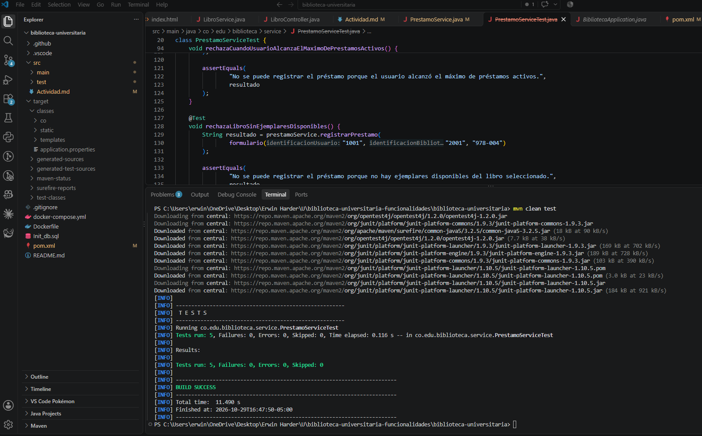
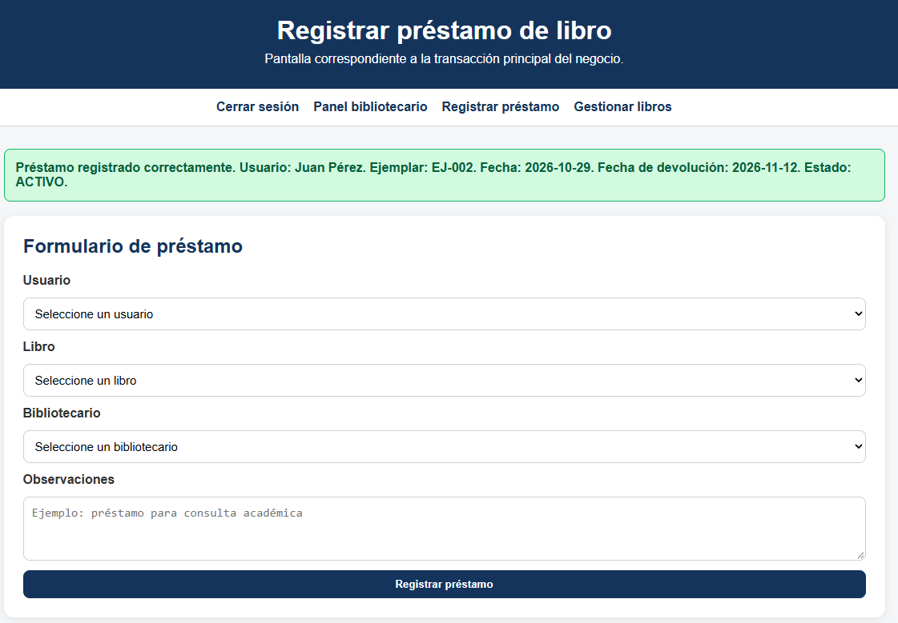
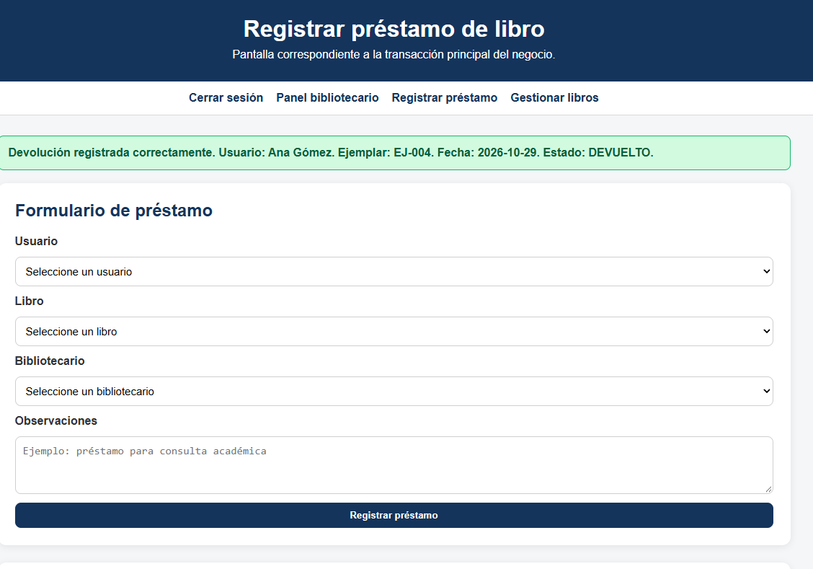

# Solución

## **Funcionalidad seleccionada: F-02 — Registro de préstamos.**

**Objetivo:** Analizar la funcionalidad de registro de préstamos del Sistema de Gestión de Biblioteca Universitaria, identificando sus reglas de negocio, los componentes arquitectónicos involucrados y las validaciones implementadas en el código fuente.

## **Requisitos y reglas de negocio recuperados:**

* El usuario, el bibliotecario y el libro deben existir para registrar el préstamo.
* El usuario debe encontrarse en estado ACTIVO.
* El usuario no debe tener multas pendientes.
* El usuario no puede superar el máximo de tres préstamos activos.
* El libro debe tener al menos un ejemplar en estado DISPONIBLE.
* El préstamo debe registrar la fecha de inicio y establecer la fecha de devolución a los 14 días.
* Al registrar el préstamo, el ejemplar seleccionado debe cambiar a estado PRESTADO.

## **Arquitectura y componentes relacionados:**

La funcionalidad está implementada principalmente en PrestamoController.java y PrestamoService.java. También intervienen las clases Prestamo.java, Usuario.java, Bibliotecario.java, Libro.java y Ejemplar.java, junto con las enumeraciones EstadoPrestamo.java, EstadoUsuario.java y EstadoEjemplar.java. La interfaz correspondiente se encuentra en src/main/resources/templates/prestamos.html.

**Alcance delimitado:** El análisis se centrará en el método registrarPrestamo() de PrestamoService.java, donde se concentran las validaciones previas al registro. Se evaluará la organización de estas decisiones y la posibilidad de refactorizarlas mediante el patrón Chain of Responsibility, conservando las reglas de negocio y el comportamiento esperado.

## **Rastreo de controladores, servicios, entidades, persistencia y pruebas**

**Funcionalidad: F-02 — Registro de préstamos.**

**Objetivo:** Identificar los componentes que intervienen en el registro de préstamos, sus responsabilidades, las entidades involucradas, el mecanismo de almacenamiento y las pruebas disponibles.

**Controladores:** PrestamoController.java recibe las solicitudes HTTP para mostrar el formulario de préstamos, registrar préstamos y procesar devoluciones. Antes de ejecutar estas operaciones, comprueba que la sesión tenga el rol BIBLIOTECARIO.

**Servicios:** PrestamoService.java contiene la lógica de negocio para registrar préstamos y devoluciones. Valida la existencia del usuario, el bibliotecario y el libro; comprueba el estado activo del usuario, las multas pendientes, el límite de tres préstamos activos y la disponibilidad de ejemplares. También establece el plazo de devolución de 14 días. LibroService.java permite localizar libros y BibliotecaService.java proporciona acceso a los datos de la biblioteca.

**Entidades y modelos:** intervienen Prestamo.java, Usuario.java, Bibliotecario.java, Libro.java, Ejemplar.java y Multa.java. Las enumeraciones EstadoPrestamo.java, EstadoUsuario.java y EstadoEjemplar.java representan los estados utilizados en las validaciones.

**Persistencia:** el código inspeccionado utiliza listas y objetos Java en memoria para almacenar los préstamos y las demás entidades. Aunque pom.xml incluye el controlador de MariaDB y application.properties contiene parámetros de conexión, no se identificó en el flujo revisado una capa de repositorios que persista los préstamos en esa base de datos. El README.md confirma que los datos de prueba se cargan en memoria y se pierden al reiniciar la aplicación.

## **Pruebas:**

## **Prueba 1. Registro exitoso de un préstamo**

**Objetivo:** comprobar que un usuario activo puede recibir un libro cuando cumple todas las condiciones.

**Procedimiento:**

1. Abrir la pantalla de registro de préstamos.
2. Seleccionar el usuario 1001 - Juan Pérez.
3. Seleccionar el libro 978-001 - Ingeniería de Software, que dispone de ejemplares disponibles en los datos iniciales.
4. Seleccionar un bibliotecario, por ejemplo, 2001 - Marta López.
5. Escribir una observación.
6. Presionar el botón Registrar préstamo.

**Resultado esperado:** el sistema muestra un mensaje de confirmación, el préstamo aparece en la tabla con estado ACTIVO y el ejemplar utilizado cambia a estado PRESTADO. La fecha de devolución debe corresponder a 14 días después de la fecha de inicio.

## **Prueba 2. Rechazo por multas pendientes**

**Objetivo:** verificar que un usuario con multas pendientes no puede registrar un nuevo préstamo.

**Procedimiento:**

1. Abrir la pantalla de registro.
2. Seleccionar un usuario que tiene una multa pendiente.
3. Seleccionar un libro con ejemplares disponibles.
4. Seleccionar un bibliotecario.
5. Presionar Registrar préstamo.

**Resultado esperado:** el sistema rechaza la operación y muestra un mensaje indicando que el usuario tiene multas pendientes. No debe añadirse un nuevo préstamo ni cambiarse el estado del ejemplar seleccionado.

## **Prueba 3. Rechazo por usuario inactivo**

**Objetivo:** comprobar que los usuarios inactivos no pueden solicitar préstamos.

**Procedimiento:**

1. Abrir la pantalla de registro.
2. Seleccionar 1004 - Laura Martínez, cuyo estado inicial es INACTIVO.
3. Seleccionar un libro disponible y un bibliotecario.
4. Presionar Registrar préstamo.

**Resultado esperado:** el sistema rechaza la solicitud con el mensaje correspondiente al estado inactivo. No debe registrarse el préstamo.

## **Prueba 4. Rechazo por límite de préstamos activos**

**Objetivo:** comprobar que el sistema no permite superar los tres préstamos activos por usuario.

Procedimiento:

1. Utilizar un usuario activo sin multas pendientes.
2. Registrar préstamos hasta que ese usuario tenga tres préstamos activos, o preparar los datos de prueba para alcanzar esa condición.
3. Intentar registrar un cuarto préstamo con un libro que tenga ejemplares disponibles.
4. Revisar el mensaje devuelto por la aplicación y la lista de préstamos.

**Resultado esperado:** el sistema rechaza el cuarto préstamo e informa que el usuario alcanzó el máximo de préstamos activos.

## **Hallazgos:**

**Objetivo:** Inspeccionar el código fuente de la funcionalidad de registro de préstamos, verificar la organización de sus componentes e identificar tres hallazgos que permitan proponer mejoras sin alterar las reglas de negocio existentes.

**Método de inspección:** Se revisan PrestamoController.java, PrestamoService.java, los modelos relacionados, las clases de estados y la documentación del proyecto. También se definen comprobaciones manuales para contrastar el comportamiento esperado de la aplicación.

## Hallazgo 1. Duplicación de validaciones en el servicio de préstamos

**Categoría: Mantenibilidad y diseño del código.**

**Evidencia en el código:** En PrestamoService.java, el método registrarPrestamo() contiene validaciones relacionadas con el estado del usuario, las multas pendientes, el límite de préstamos activos y la disponibilidad de ejemplares. El método solicitarPrestamoComoUsuario() contiene comprobaciones similares.

**Problema identificado:** La existencia de validaciones repetidas puede dificultar el mantenimiento. Si una regla de negocio cambia, es necesario comprobar que ambos métodos sigan aplicando el mismo criterio.

**Verificación manual propuesta:**

1. Ejecutar la aplicación y registrar un préstamo desde la interfaz de bibliotecario.
2. Intentar una solicitud desde la interfaz de usuario.
3. Comprobar cómo responde cada flujo ante un usuario inactivo o con multas pendientes.
4. Comparar los mensajes y resultados para identificar diferencias.

**Mejora propuesta:** Evaluar la extracción de las validaciones a componentes independientes, por ejemplo mediante el patrón Chain of Responsibility, de modo que las reglas puedan reutilizarse y probarse por separado.

## **Hallazgo 2. Almacenamiento de préstamos en memoria**

**Categoría:** Persistencia y conservación de la información.

**Evidencia en el código:** PrestamoService.java obtiene y modifica la lista de préstamos mediante bibliotecaService.getBiblioteca().getPrestamos(). El registro agrega el objeto del préstamo a esa lista. En el flujo revisado no se identificó una operación de persistencia mediante un repositorio de base de datos.

**Problema identificado:** Los cambios realizados durante la ejecución no se conservan al detener o reiniciar la aplicación. Esto limita la conservación de los préstamos registrados.

**Verificación manual propuesta:**

1. Ejecutar la aplicación.
2. Registrar un préstamo válido.
3. Confirmar que el préstamo aparece en la interfaz.
4. Detener la aplicación y volver a iniciarla.
5. Consultar nuevamente la lista de préstamos y comparar el resultado.

**Resultado esperado:** Si el almacenamiento continúa siendo exclusivamente en memoria, el préstamo creado durante la ejecución anterior no se conservará después del reinicio.

Mejora propuesta: Evaluar la incorporación de una capa de persistencia mediante repositorios y una base de datos. Esta mejora debe tratarse por separado de la refactorización de las validaciones para mantener acotado el alcance del taller.

**Hallazgo 3. Ausencia de pruebas automatizadas localizadas**
Categoría: Verificación y calidad del software.

**Evidencia en el proyecto:** En el ZIP inspeccionado no se identificó una carpeta src/test/ con pruebas automatizadas. El README describe escenarios manuales para verificar el registro y rechazo de préstamos, pero no constituye evidencia de una suite automatizada ejecutada.

**Problema identificado:** Sin pruebas automatizadas localizadas, resulta más difícil comprobar rápidamente que las reglas de negocio siguen funcionando después de modificar el servicio.

**Verificación manual propuesta:**

1. Registrar un préstamo con un usuario activo, sin multas pendientes y con un ejemplar disponible.
2. Intentar registrar un préstamo con un usuario inactivo.
3. Intentar registrar un préstamo con multas pendientes.
4. Intentar superar el límite de tres préstamos activos.
5. Intentar prestar un libro sin ejemplares disponibles.
6. Registrar una devolución y comprobar el cambio de estado del préstamo y del ejemplar.

# Clasificar, priorizar y realizar commit documental

Este texto está preparado para pegarlo directamente en `src/Actividad.md` o en el informe del taller.

## Clasificación y priorización de los hallazgos

Se identificaron tres hallazgos en la funcionalidad F-02 — Registro de préstamos. La prioridad se asignó considerando el impacto sobre la mantenibilidad, la conservación de la información y la verificación del comportamiento del sistema.

| ID   | Hallazgo                                                                           | Categoría               | Prioridad | Justificación                                                                                                  |
| ---- | ---------------------------------------------------------------------------------- | ------------------------ | --------- | --------------------------------------------------------------------------------------------------------------- |
| H-01 | Duplicación de validaciones en los métodos de registro de préstamos.            | Mantenibilidad y diseño | Alta      | Puede generar inconsistencias si una regla de negocio se modifica en un flujo y no en el otro.                  |
| H-02 | Almacenamiento de préstamos en memoria, sin persistencia permanente identificada. | Persistencia             | Media     | Los datos registrados durante la ejecución pueden perderse al reiniciar la aplicación.                        |
| H-03 | No se localizaron pruebas automatizadas para la funcionalidad.                     | Calidad y pruebas        | Alta      | Dificulta comprobar de forma repetible que las reglas de negocio se mantienen después de modificar el código. |

**Hallazgo seleccionado para la refactorización: H-01 — Duplicación de validaciones en los métodos de registro de préstamos.**

Se selecciona este hallazgo porque permite realizar una mejora acotada en `PrestamoService.java`, conservar las reglas de negocio actuales y comprobar que los resultados anteriores continúan siendo los esperados. No se modificará la persistencia ni se cambiará el alcance general de la aplicación.

**Preparar comprobaciones, implementar un cambio acotado.**

**Ejecución satisfactoria de las pruebas automatizadas de la funcionalidad F-02.**

Se ejecutó el comando clean para verificar la compilación del proyecto y ejecutar las pruebas automatizadas de PrestamoServiceTest. El resultado fue satisfactorio: se ejecutaron cinco pruebas, sin fallos, errores ni pruebas omitidas. Esta evidencia respalda el funcionamiento de los escenarios evaluados después de la refactorización.

**Ejecutar pruebas; comparar antes y después**

## Comparar antes y después

La captura de Maven que me compartiste ya demuestra que las cinco pruebas automatizadas posteriores a la refactorización terminaron sin fallos. Para hacer una comparación rigurosa, necesitamos también los resultados anteriores al cambio.

| Aspecto                           | Antesdelarefactorización                                                                                                     | Despuésdelarefactorización                                                                                                                      |
| --------------------------------- | ----------------------------------------------------------------------------------------------------------------------------- | ------------------------------------------------------------------------------------------------------------------------------------------------- |
| Validacionesdelusuario            | Lasvalidacionesdelestadodelusuario,lasmultaspendientesyellímitedepréstamosactivosestabanrepetidasenlosdosflujosdepréstamo. | Lasvalidacionescompartidassecentralizaronenelmétodo`validarCondicionesUsuario()`,reduciendoladuplicacióndelcódigo.              |
| Organizacióndelalógicadenegocio | Cadaflujoconteníasuspropiascomprobaciones,loquedificultabaelmantenimientodelasreglas.                                        | Losdosflujosreutilizanunmétodocomúnparavalidarlascondicionesdelusuario.                                                                         |
| Mensajesderespuesta               | Cadaflujodevolvíamensajesespecíficossegúnlareglaincumplida.                                                                | Seconservaronmensajesespecíficosparaelregistrodepréstamosylassolicitudesrealizadasdesdeelcatálogo.                                             |
| Pruebasautomatizadas              | NosehabíanlocalizadopruebasautomatizadasparalafuncionalidadF-02.                                                             | Seincorporó`PrestamoServiceTest.java` concincopruebasautomatizadas.                                                               |
| Verificacióndereglasdenegocio    | Lascomprobacionesdependíanprincipalmentedelarevisióndelcódigoydelaejecuciónmanual.                                        | Sedisponedepruebasautomatizadasparaverificarelregistroválidoyelrechazoporusuarioinactivo,multaspendientes,límitedepréstamosyfaltadeejemplares. |

Las capturas evidencian la refactorización realizada en PrestamoService para abordar el hallazgo H-01, relacionado con la duplicación de validaciones en los métodos de registro y solicitud de préstamos. Se centralizaron las comprobaciones compartidas en el método validarCondicionesUsuario, que verifica el estado del usuario, la existencia de multas pendientes y el límite de préstamos activos. De esta manera, se reduce la repetición de código y se facilita el mantenimiento de las reglas de negocio.

La refactorización conserva mensajes específicos para cada flujo. La ejecución de las cinco pruebas automatizadas finalizó satisfactoriamente, lo que respalda los escenarios evaluados. La verificación completa de la conservación del comportamiento se finalizará con las comprobaciones manuales y la comparación de resultados correspondientes.
